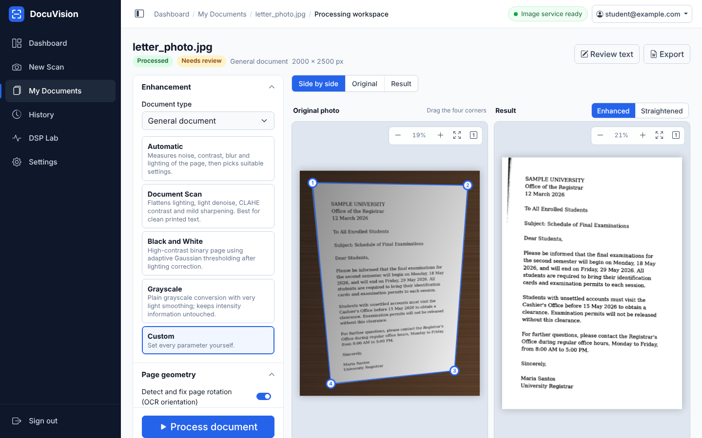
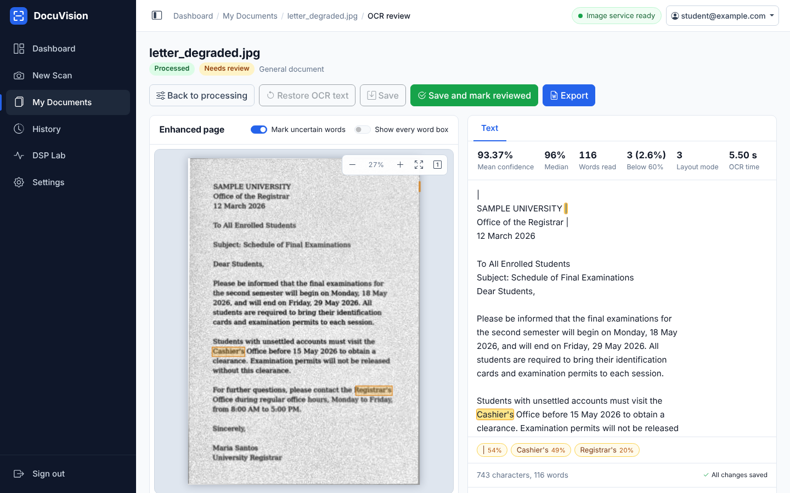
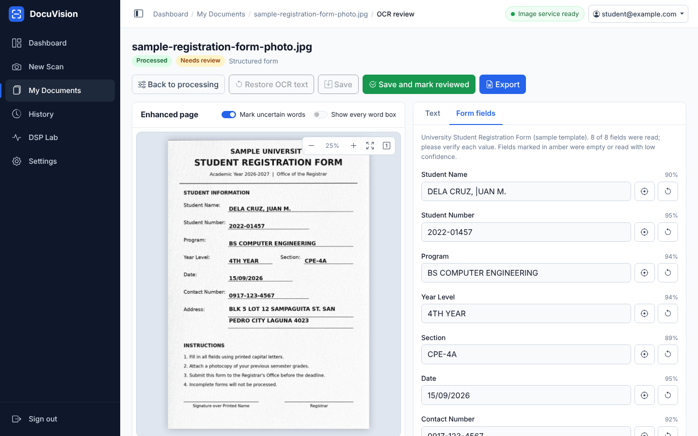

# DocuVision

**A Web-Based Document Enhancement and Automated Form Digitization System Using Digital Image Processing and Optical Character Recognition**

DocuVision turns a phone photo or scan of a paper document into a straightened, enhanced page, reads the text with Tesseract OCR, lets you review and correct it, and exports an editable Word (`.docx`) file. For forms that match a template it can also extract the individual fields (name, student number, date ...) into a table.

All processing runs on your own computer: no cloud service, no paid OCR, no API keys.



| OCR review with uncertain words marked | Structured form fields |
| --- | --- |
|  |  |

*Screenshots are taken from the running application with the synthetic sample documents that ship with the project.*

> **Installing on Windows?** Go straight to [INSTALLATION.md](INSTALLATION.md). The short version is
> `.\scripts\setup.ps1` once, then `.\scripts\start.ps1`, then open <http://localhost:3000>.

---

## 1. Architecture

```
 Browser (HTML5, CSS3, Bootstrap 5, vanilla JS, Canvas, MediaDevices camera)
    |   session cookie + CSRF token
    v
 Node.js / Express 5  (port 3000)                   Python / FastAPI  (127.0.0.1:8001)
   - registration, login, sessions                    - page detection, perspective correction
   - upload validation, private file storage          - orientation, deskew
   - SQLite database (node:sqlite)          ----->    - enhancement (DSP filters)
   - job tracking, ownership checks         HTTP      - Tesseract OCR, form extraction
   - serves the pages and the REST API   X-Service-    - python-docx export
                                             Token      (never touches users or the database)
    |                                                          |
    +---------------------- shared storage folder ------------+
                       storage/uploads  storage/processed  storage/exports
```

* The browser only ever talks to Express. The Python service listens on `127.0.0.1` and requires a shared secret (`CV_SERVICE_TOKEN`) in the `X-Service-Token` header.
* Express and Python exchange **server-generated storage keys** (for example `processed/<uuid>/enhanced.png`), never client-supplied paths. Both sides reject keys that escape the storage folder.
* Processing is a background job with stages (`geometry` -> `enhancement` -> `ocr` -> `done`). The browser polls `/api/documents/:id/status` and shows the current stage. Only one job per document can be active.
* The Python service does not know about users or documents; it reads an image, returns results and writes derived files. All database records are written by Node.

## 2. Features

**Web application**
* Registration, login, logout, password change; protected pages and API.
* Dashboard with real figures from the database: documents by processing and review status, exports, average OCR confidence, processing-job statistics, uploads per day for the last week, and the most recent documents.
* New Scan: drag and drop, file browser or live camera capture; step indicator; choice between *General document* and *Structured form*.
* Processing workspace: side-by-side / original / result views, zoom and pan, 90-degree rotation, **four draggable corner handles** (also keyboard operable) that edit the real image-pixel coordinates, presets and every enhancement parameter, OCR controls, live job stage.
* OCR review: editable text, uncertain words highlighted on the page and in the text, confidence statistics, structured field editor with per-field confidence and "show where this was read", reviewed status.
* Export: preview, A4 Times New Roman 12 pt `.docx`, text-only or table layout, download, export history.
* My Documents (search, filter, sort), History (processing runs and exports), Settings (defaults and password), DSP Lab.
* Collapsible sidebar, responsive layout, keyboard focus styles.

**Image processing (OpenCV + NumPy, no learned models)** - see section 3.

**OCR and forms** - Tesseract `image_to_string` and `image_to_data` (word boxes and confidences), low-confidence marking, template-based form extraction with automatic fallback to general OCR - see section 4.

## 3. How the image processing works

| Stage | Method | Main functions |
| --- | --- | --- |
| Page detection | Grayscale, Gaussian blur, two candidate sources (Canny edges + closing; Otsu brightness + closing), contours, convex hull and polygon approximation, then **scoring** of every candidate quadrilateral by area, convexity and angles, rectangularity, aspect plausibility, edge support along its sides and paper-versus-surround contrast. Falls back to the full frame, and says so, when nothing scores well. | `cvtColor`, `GaussianBlur`, `Canny`, `threshold(OTSU)`, `findContours`, `approxPolyDP`, `minAreaRect` |
| Perspective correction | Four-point homography from the (detected or user-adjusted) corners to an upright rectangle. The output size comes from the measured page edges (no side is ever shrunk); when the perspective is strong, a pinhole-camera model recovers the page's true aspect ratio so the flattened page is not stretched. | `getPerspectiveTransform`, `warpPerspective` |
| Orientation (0/90/180/270) | Tesseract OSD when confident; otherwise a projection-profile test for line direction plus OCR scoring of the two remaining candidates with a required margin; reported as *unreliable* instead of guessing. | `image_to_osd`, `image_to_data` |
| Deskew | Projection-profile analysis: rotate through candidate angles (1 degree coarse search, 0.1 degree refinement) and keep the angle with the sharpest row-sum profile (maximum variance). Confidence ratio reported. | `warpAffine`, NumPy |
| Enhancement | Grayscale conversion; bicubic up-sampling / area down-sampling; **illumination correction** (page divided by a large low-pass of its morphologically closed copy); Gaussian, median or bilateral noise reduction; histogram equalisation and/or CLAHE; unsharp masking or a 3x3 Laplacian kernel; Otsu or adaptive Gaussian thresholding; morphology on the ink. | `cvtColor`, `resize`, `GaussianBlur`, `medianBlur`, `bilateralFilter`, `createCLAHE`, `filter2D`, `adaptiveThreshold`, `morphologyEx` |

**Presets:** *Automatic*, *Document Scan*, *Black and White*, *Grayscale*, *Custom* (every parameter editable). The *Automatic* preset measures the page (noise, contrast, blur, lighting) and chooses parameters. Its noise estimate is the larger of an Immerkaer Laplacian estimate and a flat-block estimate; the second one is needed because camera noise is spatially correlated and the Laplacian under-reports it. During development this was calibrated on synthetic white and correlated noise, and a regression test (`test_automatic_preset_keeps_noisy_pages_readable`) now guards it.

Enhancement does not recover detail the camera never captured; up-sampling only gives OCR larger glyphs.

## 4. OCR and form digitization

* **General document** (mode A): page-segmentation mode selectable (auto, single column, single block, sparse text); full text, words with boxes and confidence, paragraphs, mean/median confidence, words below the threshold (60 %).
* **Structured form** (mode B): the page is matched against a JSON **template** (title keywords are OCR'd from the title region and fuzzy-compared). On a match, each field is read from its own *relative* region with its own page-segmentation mode and optional character whitelist, after ruling-line removal and up-scaling. Each value gets a confidence and a **plausibility check** for its type (a name containing digits or stray symbols, a date that is not a date, ...); suspicious fields are flagged with the reason.
* If the page does not match any template, DocuVision says so and falls back to general OCR. It does **not** claim to understand arbitrary forms.
* One sample template ships: `cv-service/templates/university_registration.json`. To add your own, copy it, change `id`, `name`, `identification` and `fields` (`key`, `label`, `type` = `name | id | phone | date | text | multiline`, `region` = `[x, y, width, height]` as fractions of the straightened page, optional `psm`/`whitelist`), and restart the CV service. Every `*.json` in that folder is offered in the *Structured form* mode. (The `layout` block of the sample is only used by `tests/fixtures/generate_fixtures.py` to draw the synthetic test form.)
* The OCR text and field values you correct are stored next to the original OCR output; "Restore OCR text" brings the original back.

## 5. DOCX export

`python-docx` builds the file: A4 page, 2.54 cm margins, document defaults and **every run in Times New Roman 12 pt** (also for East-Asian font slots), real editable text only (never an embedded picture). *Text* export keeps paragraphs; *Form* export produces a two-column table of field and value, optionally followed by the full recognised text. The tests re-open the generated files with `python-docx` and check these properties.

## 6. DSP Lab

Compares OCR on the same photo under four configurations:

| | Configuration |
| --- | --- |
| A | OCR on the unmodified upload |
| B | perspective + orientation + deskew, then OCR |
| C | enhancement only, then OCR |
| D | complete pipeline, then OCR |

Reports time per stage, Tesseract's mean confidence and the number of uncertain words. **CER and WER are computed only when you paste the true text** of the page, because accuracy cannot be measured without ground truth (Tesseract's confidence is the engine's self-estimate, not an accuracy). Results can be downloaded as CSV. As an example, on the bundled degraded letter photo with its known reference text the integration test measures CER 0.68 % for A and 0.00 % for D. That is one synthetic page, not a general claim.

## 7. Configuration

All settings live in `.env` (created by `scripts/setup.ps1` / `npm run setup:env`, which also generates the two secrets). See `.env.example` for comments.

| Variable | Default | Meaning |
| --- | --- | --- |
| `PORT`, `HOST` | `3000`, `127.0.0.1` | Web application address. Keep `127.0.0.1` unless you add HTTPS. |
| `SESSION_SECRET` | generated | Signs the session cookie (required in production). |
| `COOKIE_SECURE` | `false` | Set `true` only behind HTTPS. |
| `BCRYPT_ROUNDS` | `12` | Password hashing cost. |
| `DATABASE_PATH` | `./data/docuvision.sqlite` | SQLite file (created automatically). |
| `STORAGE_PATH` | `./storage` | Private file storage shared by both services. |
| `MAX_UPLOAD_SIZE` | `10485760` | Largest upload in bytes. |
| `MAX_IMAGE_PIXELS` | `40000000` | Largest decoded image, enforced by both services. |
| `CV_SERVICE_URL` | `http://127.0.0.1:8001` | Where Express finds the Python service. |
| `CV_SERVICE_TOKEN` | generated | Shared secret between the two services (required). |
| `CV_HOST`, `CV_PORT` | `127.0.0.1`, `8001` | Where the Python service listens. Keep it on localhost. |
| `CV_TIMEOUT_MS` | `180000` | Per-request timeout used by Express. |
| `TESSERACT_CMD` | empty | Full path to `tesseract.exe`; empty = auto-detect (PATH, then `C:\Program Files\Tesseract-OCR`). |
| `OCR_TIMEOUT_SECONDS` | `90` | Abort a single OCR run after this long. |
| `CV_PYTHON` | unset | Optional: interpreter used by `npm run dev` / `npm run start:cv`. |

## 8. Project structure

```
DocuVision/
  backend/            Express app: routes, controllers, middleware, services, SQLite schema (database/schema.sql)
  cv-service/         FastAPI service: processing/ (detection, perspective, orientation, deskew, enhancement,
                      pipeline, evaluation), ocr/ (recognition, layout, form_extraction), export/ (docx_generator),
                      templates/ (form templates), check_env.py
  frontend/           views/ (EJS pages, partials) and public/ (css, js, assets)
  shared/             processing_schema.json - parameter ranges and presets read by BOTH services
  scripts/            setup.ps1, start.ps1, dev.js, start-cv.js, ensure-env.js, common.js
  tests/              backend/ (node:test), cv/ (pytest), integration/ (real end-to-end), fixtures/ (synthetic)
  docs/screenshots/   images used by this README
  storage/            created at first run: uploads/, processed/, exports/
```

## 9. HTTP API

JSON everywhere, errors as `{ "error": { "code", "message", "details?" } }`. All routes except `/auth/*`, `/healthz` and the pages `/login`, `/register` need a signed-in session; every state-changing request needs the `X-CSRF-Token` header (get it from `GET /auth/csrf`). Another user's document is reported as `404`.

| Area | Endpoints |
| --- | --- |
| Auth | `GET /auth/csrf`, `POST /auth/register`, `POST /auth/login`, `POST /auth/logout` |
| Documents | `GET/POST /api/documents`, `GET/PATCH/DELETE /api/documents/:id`, `GET /api/documents/:id/original|corrected|enhanced` |
| Processing | `POST /api/documents/:id/detect`, `POST /api/documents/:id/process`, `GET /api/documents/:id/status`, `GET /api/jobs`, `GET /api/processing/schema` |
| OCR | `GET/PATCH /api/documents/:id/ocr`, `POST /api/documents/:id/reprocess-ocr`, `GET /api/templates` |
| Export | `POST /api/documents/:id/export`, `GET /api/documents/:id/exports`, `GET /api/exports`, `GET /api/exports/:id/download`, `DELETE /api/exports/:id` |
| DSP Lab | `POST/GET /api/documents/:id/experiments`, `GET /api/experiments`, `GET /api/experiments/:runId`, `GET /api/experiments/:runId/csv`, `DELETE /api/experiments/:runId` |
| Account / system | `GET/PUT /api/settings`, `POST /api/settings/password`, `GET /api/dashboard`, `GET /api/health`, `GET /healthz` |

The CV service (`/v1/validate`, `/v1/detect`, `/v1/geometry`, `/v1/enhance`, `/v1/ocr`, `/v1/docx`, `/v1/experiments`, `/v1/templates`, `/health`) is internal; its API reference is served at `http://127.0.0.1:8001/docs` while it runs (calls to `/v1/*` still need the token header).

## 10. Database

SQLite through Node's built-in `node:sqlite` (no native module to compile). Tables: `users`, `documents`, `processing_jobs`, `ocr_results`, `document_exports`, `sessions` (the session store), plus `experiment_runs` (DSP Lab) and `user_settings`. Foreign keys are enforced; deleting a document removes its files and rows. A partial unique index prevents two active jobs for one document, and jobs left "running" by a crash are marked failed on the next start. The schema is `backend/database/schema.sql`; `npm run db:init` creates the file (it is also created automatically on first start).

## 11. Security

* Passwords hashed with **bcryptjs**; login timing is equalised for unknown users; login attempts are rate limited.
* Session id regenerated on login and on password change; cookie `dv.sid` is `HttpOnly`, `SameSite=Lax` (`Secure` when `COOKIE_SECURE=true`); sessions stored in SQLite and expire.
* **CSRF**: synchronizer token required on every state-changing route.
* Content-Security-Policy with `script-src 'self'` (no inline scripts), `frame-ancestors 'none'`, `nosniff`, `X-Frame-Options`, `Permissions-Policy` (camera only for the site itself), `Cache-Control: no-store` on private responses. The front end builds the page with `textContent`, never `innerHTML`.
* Uploads are validated by **file content** (PNG/JPEG signature and decoded dimensions), size and pixel limits, and stored under server-generated names in a private folder that is never served statically. Download names are sanitised.
* Every document, export and experiment access checks ownership.
* No stack traces or internal paths in responses. Secrets only in `.env` (git-ignored). The CV service binds to localhost and requires the shared token.

## 12. Testing

```powershell
npm test                    # Node backend tests (node:test), 123 tests
npm run test:cv             # Python tests (pytest), 138 tests - run with the .venv active
npm run test:integration    # real Express + real Python service + real Tesseract, 10 checks
npm run check               # is Python, every Python package and Tesseract usable?
```

* **Backend (123)**: auth, validation, ownership isolation, upload rules, processing job lifecycle (success, failure, stop/restart recovery, duplicate jobs), OCR edit/restore, export, CSRF on every state-changing route, headers, sessions, rate limiting, the Node-to-Python client contract. The Python service is replaced by a stub that writes real image and `.docx` files.
* **CV (138)**: detection against known corner ground truth, perspective, orientation (0/90/180/270), deskew accuracy, every enhancement stage and preset, noise estimation, OCR against known text, form extraction and plausibility checks, DOCX properties, the FastAPI endpoints and their error handling, CER/WER maths.
* **Integration (10)**: upload -> detect (corner error against ground truth) -> process -> OCR (CER against the reference text) -> edit -> export -> independent `python-docx` check of font, size and A4 -> structured form flow -> re-run OCR -> DSP Lab with CSV -> clear error when the CV service is down. It starts the Python service itself and **skips with a reason** if Python packages or Tesseract are missing.
* All fixtures are synthetic (generated by `tests/fixtures/generate_fixtures.py`); no real student data is included.

## 13. Known limitations

* **OCR quality depends on the photo.** Tesseract works well on printed text; handwriting, very low resolution, strong glare, heavy blur and decorative fonts are unreliable. Noisy pages can produce stray characters such as `|` at page edges; that is why uncertain words are marked for review.
* **Forms:** only forms that have a template are understood, and the template regions assume the page is flattened and upright. A new layout needs a new template (section 4).
* **Page detection** is classical computer vision. A page on a similar-coloured surface, partly out of frame or with very low contrast may need manual corner adjustment (that is what the handles are for).
* **Orientation** relies on Tesseract OSD plus a fallback; pages with almost no text may be reported as "unreliable" and need the manual rotate button. **Deskew** handles about +/-15 degrees and is not meaningful for pages dominated by pictures.
* **Language:** English recognition data (`eng`, `osd`) is assumed. Other languages need their `.traineddata` and a code change.
* Processing jobs run one stage at a time inside the Express process and the Python service runs at most `CV_MAX_CONCURRENCY` heavy requests at once. This is built for one user or a classroom, not for many simultaneous users.
* Camera capture needs a secure context: use `http://localhost:3000` (or HTTPS), not a LAN address.
* Everything is stored unencrypted on local disk; use full-disk encryption and OS accounts for protection. There is no e-mail verification or password reset by e-mail (the application is local).
* Where it was tested: see INSTALLATION.md, "What has and has not been tested".
# Tite

